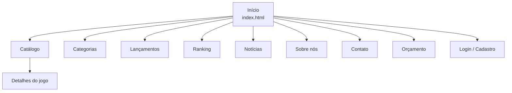

# Planejamento do site

Este documento reúne o planejamento do PixelVault, seguindo os passos do trabalho: visão geral, sitemap, inventário de conteúdo e wireframes.

## 1. Visão geral

- **Tema:** loja de jogos digitais.
- **Público-alvo:** jogadores que querem conhecer, comparar e escolher jogos.
- **Objetivo:** apresentar jogos, facilitar a escolha e receber contato e pedidos de orçamento.
- **Escopo:** 11 páginas HTML interligadas por menu fixo e rodapé.

## 2. Sitemap



Em qualquer página, o usuário chega às principais seções pelo menu fixo no topo e pelo rodapé. A página de detalhes é acessada pelos cards.

## 3. Inventário de conteúdo

| Página | Objetivo | Conteúdo necessário |
|---|---|---|
| Início (`index.html`) | Apresentar a plataforma e destacar seus principais conteúdos. | Apresentação da PixelVault, catálogos, jogos, promoções, avaliações, notícias relacionadas e produtos em alta. |
| Catálogo (`catalogo.html`) | Apresentar os jogos disponíveis na plataforma. | Imagem dos jogos, preços, promoções, gênero dos jogos e barra de pesquisa. |
| Categorias (`categorias.html`) | Organizar os jogos conforme seus respectivos gêneros. | Catálogos divididos por gêneros, capa dos jogos, barra de pesquisa e descrição dos jogos. |
| Contato (`contato.html`) | Disponibilizar canais de comunicação entre usuários e a plataforma. | Opção de cadastro de e-mail/número de WhatsApp, acesso ao e-mail/WhatsApp da PixelVault. |
| Detalhes do jogo (`jogo.html`) | Apresentar informações específicas sobre um jogo selecionado. | Nome do jogo, capa do jogo, gênero, breve descrição da história, avaliações, preço, promoções/descontos, opção de baixar uma demo e botão de compra. |
| Lançamentos (`lancamentos.html`) | Divulgar jogos recém-lançados e futuros lançamentos. | Uma aba específica que mostre todos os jogos que foram lançados dentro de um período de um mês e jogos que irão ser lançados em breve. |
| Login (`login.html`) | Permitir que os usuários acessem ou criem uma conta. | Formulário de cadastro que peça o e-mail, senha, nome do jogador e um aceite de termos e condições. |
| Notícias (`noticias.html`) | Informar os usuários sobre novidades do mercado de games. | Lançamentos de jogos, avisos sobre inscrições de campeonatos, atualizações de campeões referente a certos campeonatos/competições e atualizações nos softwares dos games. |
| Orçamento (`orcamento.html`) | Registrar a pesquisa comparativa de domínio e hospedagem e receber pedidos de orçamento. | Tabelas de domínio e hospedagem, estimativa de custo, recomendação e formulário de orçamento. |
| Ranking (`ranking.html`) | Exibir os jogos mais bem avaliados pela comunidade. | Lista de todos os jogos, do mais avaliado ao menos avaliado, comentários dos gamers referente aos jogos, capa dos jogos, breve descrição e opção de compra. |
| Sobre nós (`sobre.html`) | Apresentar a identidade e os objetivos da PixelVault. | Missão, visão e valores da PixelVault, história e equipe. |

## 4. Wireframe de baixa fidelidade

### 4.1 Wireframe da página inicial (Home)

**Objetivo:** apresentar a plataforma, destacar jogos disponíveis e direcionar os visitantes para as principais funcionalidades.

```text
+--------------------------------------------------+
|                  PIXEL VAULT                     |
|                                                  |
| Início | Catálogo | Categorias | Lançamentos     |
| Ranking | Notícias | Sobre | Contato | Entrar    |
+--------------------------------------------------+
|                                                  |
|                 JOGUE SEM LIMITES                |
|                                                  |
|    Milhares de jogos, ofertas toda semana e      |
|             os maiores lançamentos.              |
|                                                  |
|       [ EXPLORAR CATÁLOGO ] [ LANÇAMENTOS ]      |
|                                                  |
+--------------------------------------------------+
|                  JOGOS EM DESTAQUE               |
|                                                  |
|   +-------------+ +-------------+                |
|   |  Dragon     | |  Skyward    |                |
|   |  Ashes      | |  Isles      |                |
|   |  Imagem     | |  Imagem     |                |
|   |  Avaliação  | |  Avaliação  |                |
|   |  Preço      | |  Preço      |                |
|   +-------------+ +-------------+                |
|                                                  |
|   +-------------+ +-------------+                |
|   | Shadow Blade| | Neon Drift  |                |
|   | Imagem      | | Imagem      |                |
|   | Avaliação   | | Avaliação   |                |
|   | Preço       | | Preço       |                |
|   +-------------+ +-------------+                |
|                                                  |
+--------------------------------------------------+
|                     NOVIDADES                    |
|                                                  |
|  [Notícia 1]    [Notícia 2]    [Notícia 3]       |
|                                                  |
+--------------------------------------------------+
|                     RODAPÉ                       |
|  Navegação | Institucional | Redes sociais       |
+--------------------------------------------------+
```

**Descrição:** a página inicial possui um cabeçalho com a identificação da PixelVault e um menu de navegação. Na área principal, apresenta uma chamada de destaque com botões de acesso ao catálogo e aos lançamentos. Em seguida, são exibidos cards de jogos com imagens, avaliações e preços, além de uma seção de notícias. O rodapé disponibiliza links institucionais e redes sociais.

### 4.2 Wireframe de página interna — Catálogo

**Objetivo:** organizar e apresentar os jogos disponíveis, permitindo que os visitantes visualizem as opções existentes.

```text
+--------------------------------------------------+
|                  PIXEL VAULT                     |
|                                                  |
| Início | Catálogo | Categorias | Lançamentos     |
| Ranking | Notícias | Sobre | Contato | Entrar    |
+--------------------------------------------------+
|                                                  |
|                  CATÁLOGO DE JOGOS               |
|                                                  |
|       [ Todos ] [ Ação ] [ RPG ] [ FPS ]         |
|                  [ Corrida ]                     |
|                                                  |
+--------------------------------------------------+
|                                                  |
|   +----------------+  +----------------+         |
|   |   NEON DRIFT   |  |  DRAGON ASHES  |         |
|   |                |  |                |         |
|   |     IMAGEM     |  |     IMAGEM     |         |
|   |                |  |                |         |
|   |  Corrida       |  |  RPG           |         |
|   |  Avaliação     |  |  Avaliação     |         |
|   |  Preço         |  |  Preço         |         |
|   +----------------+  +----------------+         |
|                                                  |
|   +----------------+  +----------------+         |
|   |  LAST SIGNAL   |  |  SHADOW BLADE  |         |
|   |                |  |                |         |
|   |     IMAGEM     |  |     IMAGEM     |         |
|   |                |  |                |         |
|   |  FPS           |  |  Ação          |         |
|   |  Avaliação     |  |  Avaliação     |         |
|   |  Preço         |  |  Preço         |         |
|   +----------------+  +----------------+         |
|                                                  |
+--------------------------------------------------+
|                     RODAPÉ                       |
|  Navegação | Institucional | Redes sociais       |
+--------------------------------------------------+
```

**Descrição:** a página de catálogo apresenta os jogos em cards organizados em uma grade. Na parte superior, são disponibilizados filtros por gênero, como ação, RPG, FPS e corrida. Cada card apresenta informações importantes para auxiliar o usuário na escolha do jogo.

### 4.3 Wireframe da página de contato

**Objetivo:** disponibilizar informações de atendimento e permitir que os usuários enviem mensagens à equipe da PixelVault.

```text
+--------------------------------------------------+
|                  PIXEL VAULT                     |
|                                                  |
| Início | Catálogo | Categorias | Lançamentos     |
| Ranking | Notícias | Sobre | Contato | Entrar    |
+--------------------------------------------------+
|                                                  |
|                      CONTATO                     |
|                  Fale com a gente                |
|                                                  |
|  E-mail: contato@pixelvault.com                  |
|  Telefone: (11) 4000-0000                        |
|  Localização: São Paulo, SP                      |
|  Atendimento: Segunda a sexta, 9h às 18h         |
|                                                  |
+--------------------------------------------------+
|                                                  |
|                 ENVIE SUA MENSAGEM               |
|                                                  |
|  Nome:                                           |
|  [________________________________________]      |
|                                                  |
|  E-mail:                                         |
|  [________________________________________]      |
|                                                  |
|  Mensagem:                                       |
|  [________________________________________]      |
|  [________________________________________]      |
|  [________________________________________]      |
|                                                  |
|             [ ENVIAR MENSAGEM ]                  |
|                                                  |
+--------------------------------------------------+
|                     RODAPÉ                       |
|  Navegação | Institucional | Redes sociais       |
+--------------------------------------------------+
```

**Descrição:** a página de contato apresenta os principais canais de atendimento da plataforma, incluindo e-mail, telefone, localização e horário de funcionamento. Também possui um formulário com campos para nome, e-mail e mensagem, permitindo que os visitantes encaminhem dúvidas, sugestões ou solicitações.

### 4.4 Considerações sobre os wireframes

Os wireframes estabelecem uma estrutura visual para as principais páginas do PixelVault, facilitando a organização dos elementos e o desenvolvimento da interface. A utilização de um padrão compartilhado de cabeçalho, navegação e rodapé contribui para a consistência visual e para uma experiência de utilização mais intuitiva.

As estruturas apresentadas servem como referência para a organização dos elementos HTML e sua posterior estilização com CSS.

## 5. Identidade visual

| Elemento | Definição |
|---|---|
| Fundo | Preto arroxeado `#08060f` |
| Cor principal | Roxo `#9d4dff` |
| Destaques | Azul neon `#27d3ff` e verde `#39ff88` |
| Fonte | Segoe UI, com alternativas do sistema |
| Componentes | Cards com efeito hover, botões com gradiente e animações suaves |

## 6. Organização do projeto

A estrutura de pastas está descrita no [README](README.md).
