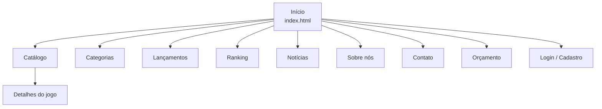

# Planejamento do site

Este documento reúne o planejamento do PixelVault, seguindo os passos do trabalho: visão geral, sitemap, inventário de conteúdo e wireframes.

## 1. Fase 0: concepção e planejamento

> Primeiro decidimos o que o site precisa ter e como o usuário irá navegar. Depois transformamos esse planejamento em código.

### 1.1 Objetivo do site

**Tema:** loja de jogos digitais.

**Objetivo:** apresentar jogos de forma organizada, ajudar o jogador a comparar e escolher o que comprar, divulgar lançamentos e notícias do mundo dos games e permitir que o visitante entre em contato ou peça um orçamento.

| Pergunta | Resposta |
|---|---|
| Qual problema ou necessidade o site pretende atender? | O jogador tem dificuldade de reunir em um só lugar o gênero, a plataforma, o preço e a avaliação de cada jogo para decidir o que comprar. |
| O que o visitante deve conseguir fazer? | Navegar pelo catálogo e filtrar por gênero, ver os detalhes de um jogo, conferir lançamentos e ranking, ler notícias, falar com a equipe, pedir um orçamento e acessar uma conta. |
| Que tipo de conteúdo será oferecido? | Cards de jogos (capa, gênero, plataforma, preço e nota), página de detalhes, ranking, notícias, páginas institucionais, formulários e uma trilha sonora em áudio. |
| Qual será o principal resultado esperado após a visita? | O visitante encontra um jogo de interesse em até 2 cliques e segue para a compra ou para o contato com a equipe. |

### 1.2 Público-alvo

```text
Público-alvo:
- jogadores de PC e de consoles (PlayStation, Xbox e Switch);
- jovens e adultos que acompanham lançamentos, notícias e campeonatos;
- pessoas que querem comparar preços, avaliações e gêneros antes de comprar;
- interessados em falar com a equipe ou pedir um orçamento.
```

O que esse público define no projeto:

| Decisão | Escolha |
|---|---|
| Linguagem | Direta, em português e com tom jovem |
| Conteúdo | Cards com as informações principais e filtros por gênero |
| Navegação | Menu fixo em todas as páginas, com acesso a qualquer conteúdo em até 2 cliques |
| Estilo visual | Tema gamer: preto, roxo, azul neon e verde |

## 2. Sitemap: mapa do site

O sitemap mostra quais páginas existem e como elas se relacionam.

```text
HOME (index.html)
├── Catálogo (catalogo.html)
│   └── Detalhes do jogo (jogo.html)
├── Categorias (categorias.html)
├── Lançamentos (lancamentos.html)
├── Ranking (ranking.html)
├── Notícias (noticias.html)
├── Sobre nós (sobre.html)
├── Contato (contato.html)
├── Orçamento (orcamento.html)
└── Login / Cadastro (login.html)
```



### 2.1 Verificação do sitemap

| Pergunta | Resposta |
|---|---|
| Existe uma página principal clara? | Sim. A `index.html` é o ponto de partida e leva a todas as outras. |
| As páginas obrigatórias foram incluídas? | Sim: `index.html`, `contato.html` e `orcamento.html`. |
| Há no mínimo 10 páginas? | Sim. São 11 páginas. |
| As páginas têm funções diferentes? | Sim. Cada página tem um objetivo próprio, descrito no inventário de conteúdo. Nenhuma é cópia de outra. |
| O usuário entende como chegar aos conteúdos principais? | Sim. O menu fixo e o rodapé aparecem em todas as páginas, e qualquer conteúdo fica a no máximo 2 cliques. |

### 2.2 Planejamento do menu

Nem todas as páginas aparecem no menu principal. O menu tem 10 links:

```text
INÍCIO | CATÁLOGO | CATEGORIAS | LANÇAMENTOS | RANKING | NOTÍCIAS | SOBRE | CONTATO | ORÇAMENTO | ENTRAR
```

A página de **Detalhes do jogo** (`jogo.html`) fica fora do menu. Ela é aberta ao clicar em um card do Catálogo, da Home, dos Lançamentos ou do Ranking, sem ocupar espaço no menu principal. Nela, o link "Voltar ao catálogo" leva de volta à lista.

## 3. Inventário de conteúdo

| Página | Objetivo | Conteúdo necessário |
|---|---|---|
| Início (`index.html`) | Apresentar a plataforma e destacar seus principais conteúdos. | Apresentação da PixelVault, catálogos, jogos, promoções, avaliações, notícias relacionadas e produtos em alta. |
| Catálogo (`catalogo.html`) | Apresentar os jogos disponíveis na plataforma. | Imagem dos jogos, preços, promoções, gênero dos jogos e barra de pesquisa. |
| Categorias (`categorias.html`) | Organizar os jogos conforme seus respectivos gêneros. | Catálogos divididos por gêneros, capa dos jogos, barra de pesquisa e descrição dos jogos. |
| Contato (`contato.html`) | Disponibilizar canais de comunicação entre usuários e a plataforma. | Opção de cadastro de e-mail/número de WhatsApp, acesso ao e-mail/WhatsApp da PixelVault. |
| Detalhes do jogo (`jogo.html`) | Apresentar informações específicas sobre um jogo selecionado. | Nome do jogo, capa do jogo, gênero, breve descrição da história, avaliações, preço, promoções/descontos, opção de baixar uma demo e botão de compra. |
| Lançamentos (`lancamentos.html`) | Divulgar jogos recém-lançados e futuros lançamentos. | Uma aba específica que mostre todos os jogos que foram lançados dentro de um período de um mês e jogos que irão ser lançados em breve. |
| Login (`login.html`) | Permitir que os usuários acessem ou criem uma conta. | Formulário de cadastro que peça o e-mail, senha, nome do jogador e um aceite de termos e condições. |
| Notícias (`noticias.html`) | Informar os usuários sobre novidades do mercado de games. | Lançamentos de jogos, avisos sobre inscrições de campeonatos, atualizações de campeões referente a certos campeonatos/competições e atualizações nos softwares dos games. |
| Orçamento (`orcamento.html`) | Registrar a pesquisa comparativa de domínio e hospedagem e receber pedidos de orçamento. | Tabelas de domínio e hospedagem, estimativa de custo, recomendação e formulário de orçamento. |
| Ranking (`ranking.html`) | Exibir os jogos mais bem avaliados pela comunidade. | Lista de todos os jogos, do mais avaliado ao menos avaliado, comentários dos gamers referente aos jogos, capa dos jogos, breve descrição e opção de compra. |
| Sobre nós (`sobre.html`) | Apresentar a identidade e os objetivos da PixelVault. | Missão, visão e valores da PixelVault, história e equipe. |

## 4. Wireframe de baixa fidelidade

### 4.1 Wireframe da página inicial (Home)

**Objetivo:** apresentar a plataforma, destacar jogos disponíveis e direcionar os visitantes para as principais funcionalidades.

```text
+--------------------------------------------------+
|                  PIXEL VAULT                     |
|                                                  |
| Início | Catálogo | Categorias | Lançamentos     |
| Ranking | Notícias | Sobre | Contato | Entrar    |
+--------------------------------------------------+
|                                                  |
|                 JOGUE SEM LIMITES                |
|                                                  |
|    Milhares de jogos, ofertas toda semana e      |
|             os maiores lançamentos.              |
|                                                  |
|       [ EXPLORAR CATÁLOGO ] [ LANÇAMENTOS ]      |
|                                                  |
+--------------------------------------------------+
|                  JOGOS EM DESTAQUE               |
|                                                  |
|   +-------------+ +-------------+                |
|   |  Dragon     | |  Skyward    |                |
|   |  Ashes      | |  Isles      |                |
|   |  Imagem     | |  Imagem     |                |
|   |  Avaliação  | |  Avaliação  |                |
|   |  Preço      | |  Preço      |                |
|   +-------------+ +-------------+                |
|                                                  |
|   +-------------+ +-------------+                |
|   | Shadow Blade| | Neon Drift  |                |
|   | Imagem      | | Imagem      |                |
|   | Avaliação   | | Avaliação   |                |
|   | Preço       | | Preço       |                |
|   +-------------+ +-------------+                |
|                                                  |
+--------------------------------------------------+
|                     NOVIDADES                    |
|                                                  |
|  [Notícia 1]    [Notícia 2]    [Notícia 3]       |
|                                                  |
+--------------------------------------------------+
|                     RODAPÉ                       |
|  Navegação | Institucional | Redes sociais       |
+--------------------------------------------------+
```

**Descrição:** a página inicial possui um cabeçalho com a identificação da PixelVault e um menu de navegação. Na área principal, apresenta uma chamada de destaque com botões de acesso ao catálogo e aos lançamentos. Em seguida, são exibidos cards de jogos com imagens, avaliações e preços, além de uma seção de notícias. O rodapé disponibiliza links institucionais e redes sociais.

### 4.2 Wireframe de página interna — Catálogo

**Objetivo:** organizar e apresentar os jogos disponíveis, permitindo que os visitantes visualizem as opções existentes.

```text
+--------------------------------------------------+
|                  PIXEL VAULT                     |
|                                                  |
| Início | Catálogo | Categorias | Lançamentos     |
| Ranking | Notícias | Sobre | Contato | Entrar    |
+--------------------------------------------------+
|                                                  |
|                  CATÁLOGO DE JOGOS               |
|                                                  |
|       [ Todos ] [ Ação ] [ RPG ] [ FPS ]         |
|                  [ Corrida ]                     |
|                                                  |
+--------------------------------------------------+
|                                                  |
|   +----------------+  +----------------+         |
|   |   NEON DRIFT   |  |  DRAGON ASHES  |         |
|   |                |  |                |         |
|   |     IMAGEM     |  |     IMAGEM     |         |
|   |                |  |                |         |
|   |  Corrida       |  |  RPG           |         |
|   |  Avaliação     |  |  Avaliação     |         |
|   |  Preço         |  |  Preço         |         |
|   +----------------+  +----------------+         |
|                                                  |
|   +----------------+  +----------------+         |
|   |  LAST SIGNAL   |  |  SHADOW BLADE  |         |
|   |                |  |                |         |
|   |     IMAGEM     |  |     IMAGEM     |         |
|   |                |  |                |         |
|   |  FPS           |  |  Ação          |         |
|   |  Avaliação     |  |  Avaliação     |         |
|   |  Preço         |  |  Preço         |         |
|   +----------------+  +----------------+         |
|                                                  |
+--------------------------------------------------+
|                     RODAPÉ                       |
|  Navegação | Institucional | Redes sociais       |
+--------------------------------------------------+
```

**Descrição:** a página de catálogo apresenta os jogos em cards organizados em uma grade. Na parte superior, são disponibilizados filtros por gênero, como ação, RPG, FPS e corrida. Cada card apresenta informações importantes para auxiliar o usuário na escolha do jogo.

### 4.3 Wireframe da página de contato

**Objetivo:** disponibilizar informações de atendimento e permitir que os usuários enviem mensagens à equipe da PixelVault.

```text
+--------------------------------------------------+
|                  PIXEL VAULT                     |
|                                                  |
| Início | Catálogo | Categorias | Lançamentos     |
| Ranking | Notícias | Sobre | Contato | Entrar    |
+--------------------------------------------------+
|                                                  |
|                      CONTATO                     |
|                  Fale com a gente                |
|                                                  |
|  E-mail: contato@pixelvault.com                  |
|  Telefone: (11) 4000-0000                        |
|  Localização: São Paulo, SP                      |
|  Atendimento: Segunda a sexta, 9h às 18h         |
|                                                  |
+--------------------------------------------------+
|                                                  |
|                 ENVIE SUA MENSAGEM               |
|                                                  |
|  Nome:                                           |
|  [________________________________________]      |
|                                                  |
|  E-mail:                                         |
|  [________________________________________]      |
|                                                  |
|  Mensagem:                                       |
|  [________________________________________]      |
|  [________________________________________]      |
|  [________________________________________]      |
|                                                  |
|             [ ENVIAR MENSAGEM ]                  |
|                                                  |
+--------------------------------------------------+
|                     RODAPÉ                       |
|  Navegação | Institucional | Redes sociais       |
+--------------------------------------------------+
```

**Descrição:** a página de contato apresenta os principais canais de atendimento da plataforma, incluindo e-mail, telefone, localização e horário de funcionamento. Também possui um formulário com campos para nome, e-mail e mensagem, permitindo que os visitantes encaminhem dúvidas, sugestões ou solicitações.

### 4.4 Considerações sobre os wireframes

Os wireframes estabelecem uma estrutura visual para as principais páginas do PixelVault, facilitando a organização dos elementos e o desenvolvimento da interface. A utilização de um padrão compartilhado de cabeçalho, navegação e rodapé contribui para a consistência visual e para uma experiência de utilização mais intuitiva.

As estruturas apresentadas servem como referência para a organização dos elementos HTML e sua posterior estilização com CSS.

## 5. Organização dos arquivos

Antes de criar os arquivos, o grupo desenhou a estrutura de pastas do projeto.

```text
projeto_frontend/
│
├── index.html
├── catalogo.html
├── categorias.html
├── jogo.html
├── lancamentos.html
├── ranking.html
├── noticias.html
├── sobre.html
├── contato.html
├── orcamento.html
├── login.html
│
├── css/
│   └── style.css
│
├── img/
│   └── (imagens do site)
│
├── assets/
│   ├── audio/
│   │   └── trilha.wav
│   ├── video/
│   └── outros/
│
└── docs/
    ├── README.md
    ├── planejamento_do_site.md
    ├── diario_de_bordo.md
    └── relatorio_orcamento.md
```

| Pasta ou arquivo | O que guarda |
|---|---|
| Raiz (`.html`) | As 11 páginas do site, todas no mesmo nível para os links serem simples |
| `css/` | O `style.css`, único e usado por todas as páginas |
| `img/` | As imagens do site (por enquanto vazia: as capas usam degradês e emojis) |
| `assets/audio/` | A trilha sonora usada na Home |
| `assets/video/` | Vídeos do site (reservada, ainda sem arquivos) |
| `assets/outros/` | Outros recursos locais |
| `docs/` | Documentação do projeto |

O projeto não tem a pasta `js/`, porque o site não usa JavaScript. Os menus, filtros e abas funcionam só com HTML e CSS. As pastas vazias têm um arquivo `.gitkeep`, porque o Git não guarda pasta vazia.

### Como a organização evita problemas

- **Links quebrados:** todos os links são relativos (por exemplo, `catalogo.html` e `css/style.css`) e foram conferidos um a um.
- **Arquivos duplicados:** o CSS é um só e o menu e o rodapé seguem o mesmo modelo em todas as páginas.
- **Dificuldade para localizar recursos:** cada tipo de arquivo tem a sua pasta.

## 6. Modelo comum para as páginas

Como o site tem muitas páginas, todas compartilham a mesma estrutura visual e semântica:

```text
HEADER
   ↓
NAV
   ↓
MAIN
   ↓
conteúdo específico da página
   ↓
FOOTER
```

O `header` e o `nav` ficam juntos em um bloco fixo no topo. O `main` guarda o conteúdo, dividido em `section`. O `footer` é igual em todas as páginas.

### Estrutura HTML semântica usada

```html
<body>
  <div class="topo">
    <input type="checkbox" id="mt">
    <header>
      <a class="logo" href="index.html">PIXEL<b>VAULT</b></a>
      <label class="bg" for="mt">☰</label>
    </header>
    <nav aria-label="Menu principal">
      <a href="index.html">Início</a>
      <a href="catalogo.html">Catálogo</a>
      <a href="sobre.html">Sobre</a>
      <a href="contato.html">Contato</a>
      <!-- demais links do menu -->
    </nav>
  </div>

  <main class="w">
    <section>
      <h1>Título da página</h1>
      <p>Conteúdo da página.</p>
    </section>
  </main>

  <footer>
    <p class="cp">© 2026 PixelVault. Projeto fictício para fins educacionais.</p>
  </footer>
</body>
```

### O que muda e o que se repete

| Parte | Em todas as páginas |
|---|---|
| `header` | Igual: logo e botão do menu no celular |
| `nav` | Igual, com o link da página atual destacado (`class="on"`) |
| `main` | Muda: título (`h1`) e conteúdo próprios, dentro de `section` |
| `footer` | Igual: navegação, institucional e redes |
| CSS | Um único arquivo, `css/style.css`, usado por todas |

## 7. Guia visual simplificado

O grupo escolheu um padrão visual básico, definido uma vez no `css/style.css` e reutilizado em todas as páginas.

| Elemento | Decisão do grupo |
|---|---|
| Cor principal | Roxo `#9d4dff` (bordas, destaques dos títulos e efeito hover dos cards) |
| Cor secundária | Azul neon `#27d3ff` (tags, cabeçalhos de tabela e foco dos campos) |
| Cor de destaque | Verde neon `#39ff88` (logo, link da página atual, botões e itens do ranking) |
| Cor de fundo | Preto arroxeado `#08060f`, com painéis em `#130f22` e `#1b1533` |
| Fonte principal | Segoe UI, com alternativas do sistema (`system-ui`, `sans-serif`) |
| Estilo dos botões | Arredondados (formato de pílula), com degradê de verde para azul e texto escuro. No hover, sobem um pouco, crescem levemente e ganham brilho verde. O botão secundário tem só o contorno roxo |
| Estilo dos cards | Fundo `#130f22`, borda fina `#2a2147` e cantos arredondados de 14 px. No hover, sobem 6 px e ganham borda e brilho roxos. As capas usam degradês coloridos |

Cores de texto: `#ece9f7` para o texto principal e `#9a93b8` para o texto de apoio.

### Padrão no CSS

```css
:root{
  --bg:#08060f;   /* fundo */
  --p:#130f22;    /* painéis e cards */
  --p2:#1b1533;   /* campos e cabeçalhos */
  --l:#2a2147;    /* bordas */
  --t:#ece9f7;    /* texto */
  --m:#9a93b8;    /* texto de apoio */
  --pu:#9d4dff;   /* cor principal */
  --bl:#27d3ff;   /* cor secundária */
  --gr:#39ff88;   /* cor de destaque */
}
```

Se a cor principal ou o estilo dos botões mudar, basta alterar o `style.css` e todas as páginas acompanham.

